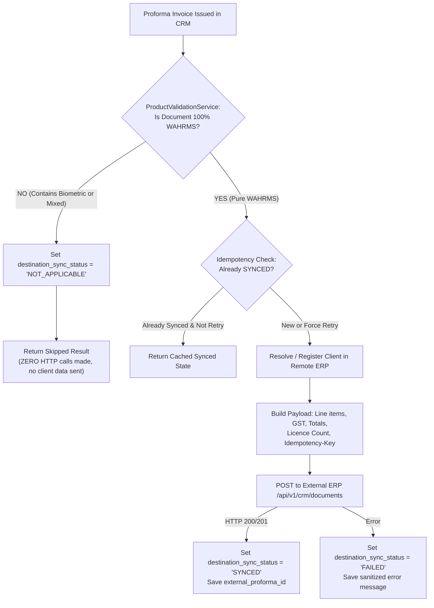

# CRM to External Website Integration: Strict Product-Category Filtering

## Overview & Business Requirement
This document specifies the authoritative business rules, architecture, and security enforcement for the synchronization between **Wa CRM** and the destination external website / billing ERP (`WA Quote ERP`).

### Core Business Policy
1. **WAHRMS Only**: Only 100% **WAHRMS** quotations and Proforma Invoices are eligible to be synchronized to the external website.
2. **Biometric Confidentiality**: **Biometric** hardware, terminals, mounting services, and associated Proforma Invoices remain **exclusively within Wa CRM** and must **never** be transferred or exposed to the external website.
3. **Strict Mixed-Product Exclusion**: Any document containing Biometric products—even if WAHRMS software is also included—is **strictly blocked** from synchronization.
4. **CRM Workflow Preservation**: Biometric documents function completely normally within CRM (PDF generation, email/download, issuing, editing) without disruption.

---

## Architecture & Product Validation

### 1. Authoritative Multi-Factor Validation (`ProductValidationService`)
Located at [`backend/services/product_validation_service.py`](file:///c:/Users/CHN/Desktop/Wa%20CRM/backend/services/product_validation_service.py).

Validation does **not** rely solely on frontend dropdowns, names, or user input. Instead, it enforces multi-factor backend verification:

| Check Factor | WAHRMS Software Criterion | Biometric Hardware Criterion |
| :--- | :--- | :--- |
| **Product Master (`wahrms_bundles`)** | `category == 'WAHRMS'` (`hr_atm`, `hr_payroll`) | `category == 'BIOMETRIC'` (`bio_standard`, `bio_atm`, `bio_enterprise`) |
| **Statutory HSN / SAC Codes** | SAC starting with `9983` (IT Software Services) | Statutory HSN starting with `8543` (e.g. `85437099` Biometric Readers & Terminals) |
| **Item Code / SKU** | `HR_ATM_SUB`, `HR_PAYROLL_SUB`, `PAYROLL_SETUP`, `WAHRMS_` | `MB160`, `BIO_STD`, `BIO_ATM`, `BIO_DEVICE`, `BIO_PAYROLL_PACKAGE` |
| **Item Description Keywords** | `wahrms`, `payroll cloud`, `leave workflow`, `shift roster`, `user license`, `attendance subscription` | `mb160`, `fingerprint`, `face scanner`, `biometric terminal`, `hardware device`, `mounting bracket`, `4g iot sim` |

### 2. Integration Statuses (`destination_sync_status`)
Tracked in the MySQL database column `quotations.destination_sync_status`:

| Status | Meaning | External Network Call? |
| :--- | :--- | :--- |
| **`NOT_APPLICABLE`** | Document contains Biometric products (Pure Biometric or Mixed). Excluded from external sync. | **NO (0 network requests)** |
| **`PENDING`** | WAHRMS Proforma issued; queued for destination synchronization. | Yes (Pending execution) |
| **`SYNCED`** | Successfully synchronized to external ERP with `external_proforma_id`. | Completed |
| **`FAILED`** | WAHRMS synchronization encountered network or credential error; ready for safe retry. | Failed, retry allowed |

---

## Outbound Synchronization Workflow (`DestinationSyncService`)
Located at [`backend/services/destination_sync_service.py`](file:///c:/Users/CHN/Desktop/Wa%20CRM/backend/services/destination_sync_service.py).



### Idempotency Protection
- Idempotency Key format: `CRM-PROFORMA-{id}-{number}`
- Sent in request headers: `Idempotency-Key: CRM-PROFORMA-49-PI-2026-0042` and `X-Idempotency-Key`
- Included in payload: `invoice_payload["idempotencyKey"]`
- When an eligible transfer is retried, the identical idempotency key is reused, preventing duplicate document creation on the destination server.

---

## Inbound External API Security & Exclusions
Located at [`backend/integrations/proforma/service.py`](file:///c:/Users/CHN/Desktop/Wa%20CRM/backend/integrations/proforma/service.py) & [`router.py`](file:///c:/Users/CHN/Desktop/Wa%20CRM/backend/integrations/proforma/router.py).

1. **`GET /api/v1/integrations/proforma` (List Proformas)**:
   - Queries `Quotation.destination_sync_status != 'NOT_APPLICABLE'`.
   - Runs `ProductValidationService` to authoritatively filter out any document containing Biometric products before returning results.
2. **`GET /api/v1/integrations/proforma/{id_or_number}` (Fetch Proforma)**:
   - If requested document is Biometric or mixed, immediately returns `404 Not Found`. Client data and pricing are never exposed.
3. **`POST /api/v1/integrations/proforma` (Ingest / Sync Proforma)**:
   - If payload contains Biometric items or category, immediately rejects with `HTTP 422 Unprocessable Entity`.

---

## Environment Variables
External API credentials are read from backend environment variables with zero plaintext secrets hardcoded in repo:
- `DESTINATION_ERP_BASE_URL` (e.g. `https://waquote.chnindia.com`)
- `DESTINATION_ERP_API_KEY` (e.g. `ed_live_...`)
- `DESTINATION_ERP_COMPANY_ID` (e.g. `chnindia`)
- Fallback: `WAQUOTE_BASE_URL`, `WAQUOTE_API_KEY`

---

## Automated Verification Tests
Automated unit tests are located at [`backend/tests/test_destination_sync_product_filter.py`](file:///c:/Users/CHN/Desktop/Wa%20CRM/backend/tests/test_destination_sync_product_filter.py).
Run tests via:
```powershell
backend\venv\Scripts\python.exe backend\tests\test_destination_sync_product_filter.py
```
**Test Coverage (9 tests, 100% passing):**
- Pure WAHRMS software documents verified and synced with licence count.
- Pure Biometric hardware documents blocked with status `NOT_APPLICABLE` and ZERO network requests.
- Mixed WAHRMS + Biometric documents blocked with status `NOT_APPLICABLE` and ZERO network requests.
- Idempotency key reuse verified.
- Inbound API rejection (422) for Biometric ingestion.
- Inbound API confidential masking (404) for Biometric document lookups.
- Manual sync retry guard verified with zero network calls.
